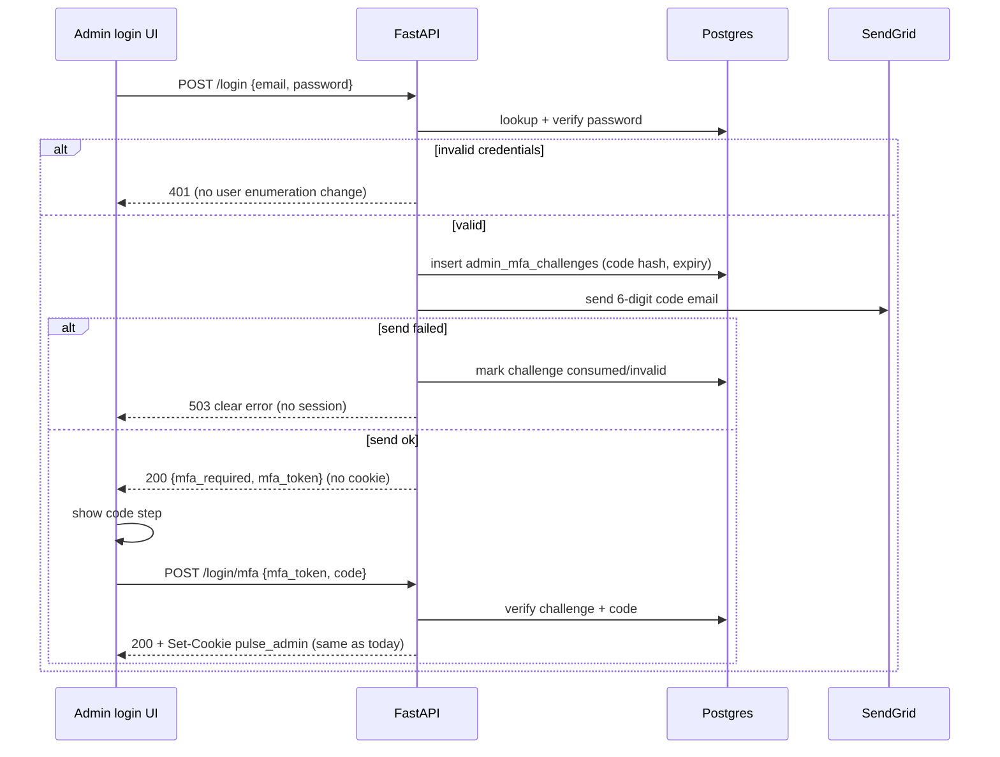

# Admin email MFA (login)

**Date:** 2026-11-08  
**Status:** Implemented  
**Primary surfaces:** `POST /api/admin/login`, new MFA verify/resend endpoints, `frontend/src/app/admin/login/page.tsx`, SendGrid via `email_service`

## Goal

Require a second factor after every successful password check for **every** console account in `admin_users` (bootstrap superuser and all invited operators — not superuser-only). A one-time code is emailed to that account’s email. No session cookie or admin JWT until the code is verified.

Newsletter subscribers have no password login (magic links only) and are out of scope.

## Non-goals

- TOTP / authenticator apps / WebAuthn
- Per-user MFA opt-out or “remember this device”
- Changing subscriber magic-link auth
- Password reset via email (existing invite/reset flows stay as they are)
- MFA only for `is_superuser` — **rejected**; all `AdminUser` rows require MFA

## Flow

## Backend

### Challenge storage

New table `admin_mfa_challenges`:

| Column | Notes |
|--------|--------|
| `id` | PK |
| `user_id` | FK → `admin_users.id` |
| `challenge_id` | UUID string, unique (embedded in `mfa_token`) |
| `code_hash` | bcrypt of 6-digit code |
| `expires_at` | UTC, default **10 minutes** from create |
| `consumed_at` | null until used or invalidated |
| `attempt_count` | failed verifies; lock after **5** |
| `created_at` | UTC |

Creating a new challenge for a user invalidates prior open challenges for that user (set `consumed_at`).

### Tokens

- **`mfa_token`**: short-lived JWT (`typ: admin_mfa`, `aud: admin`, `sub: user_id`, `cid: challenge_id`, exp ≈ 10 minutes). Signed with `ADMIN_JWT_SECRET`. Cannot authenticate admin routes (`decode_admin_token` still requires `typ: admin`).
- **Session JWT**: unchanged (`typ: admin`); issued only after MFA succeeds via existing `_issue_admin_cookie_response`.

### Endpoints

| Method | Path | Behavior |
|--------|------|----------|
| `POST` | `/api/admin/login` | Password check only. On success: create challenge, email code, return `{ mfa_required: true, mfa_token }` — **no** cookie / `access_token`. On SendGrid failure: `503` with clear detail; no session. |
| `POST` | `/api/admin/login/mfa` | Body `{ mfa_token, code }`. Verify JWT + challenge + code. Success → same cookie response as today’s login. Bad/expired/locked → `401`. |
| `POST` | `/api/admin/login/mfa/resend` | Body `{ mfa_token }`. Rate-limited; new code + email; new `mfa_token` returned. Invalidates previous open challenge. |

Rate limits (existing limiter patterns): login stays `10/minute`; MFA verify/resend similarly tight (e.g. `10/minute`).

### Email

- New `send_admin_mfa_code_email(to_email, code)` in `email_service.py` (plain + HTML, short copy, no marketing fluff).
- Code never written to application logs (log challenge_id / user_id only).

### Config

- `ADMIN_MFA_CODE_TTL_MINUTES` (default 10)
- `ADMIN_MFA_MAX_ATTEMPTS` (default 5)
- Dev/CI only: `ADMIN_MFA_DEV_CODE` — when `environment` is **not** `production` or `staging`, verification also accepts this fixed code so Playwright/pytest can complete MFA without reading inbox. Must be unset in staging/production.

## Frontend

Login page stays one composition; after successful password submit:

1. Hide email/password fields.
2. Show code field + “Verify” (primary red) + “Resend code” + “Back”.
3. Copy: code was sent to the email they used (mask if useful; full address OK for admin).
4. On verify success: same redirect rules as today (`must_change_password` → change-password, else `/admin`).
5. `data-testid`s: `admin-login-mfa-code`, `admin-login-mfa-submit`, `admin-login-mfa-resend`.

Visual language matches current dark admin login (`DESIGN.md` red/teal).

## Tests & e2e

- Backend: extend `test_admin_auth.py` — password alone no longer sets session; MFA happy path; wrong code; expired/consumed; resend; SendGrid failure → 503 and no cookie.
- Unit tests mock SendGrid; capture generated code via patch or by verifying with a known patched `secrets`/`random`.
- E2E: set `ADMIN_MFA_DEV_CODE` in Compose/CI; update `loginAsAdmin` and `admin-login-form.spec.ts` to complete MFA (API helper posts login → mfa with dev code; UI form test fills code step).

## Docs

- Note MFA in `docs/operational-runbook.md` (admin sign-in) and `.env.example` for new vars.
- No separate product marketing copy.

## Out of scope follow-ups

- SMS / authenticator apps
- MFA for non-admin accounts
- Challenge cleanup cron (optional later; expiry check on read is enough for v1)
